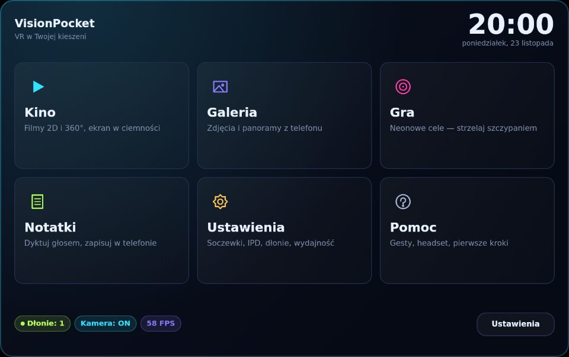
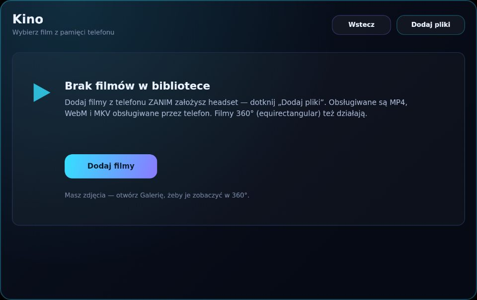
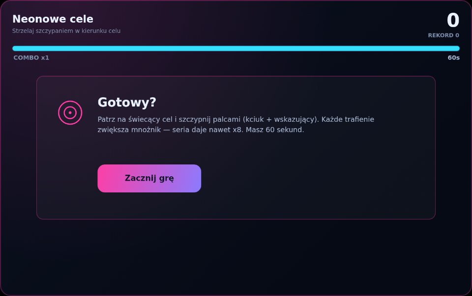
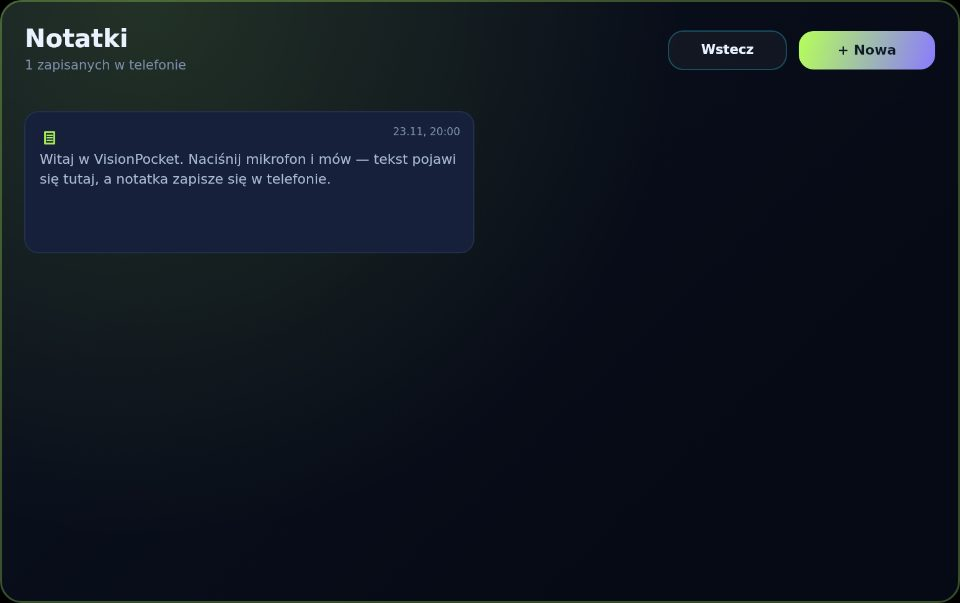
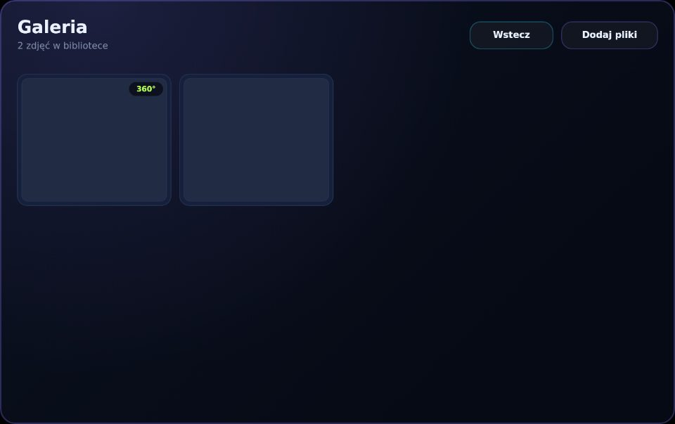
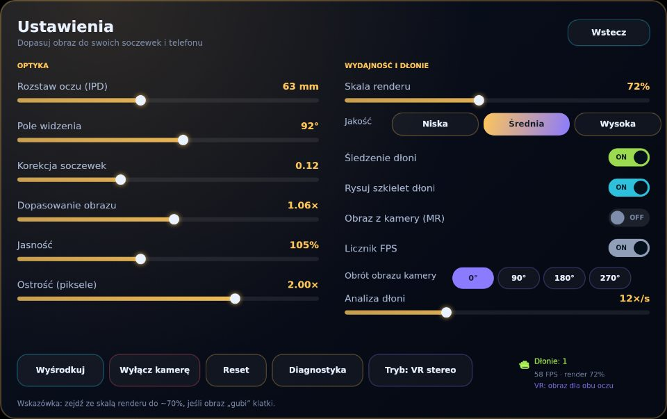
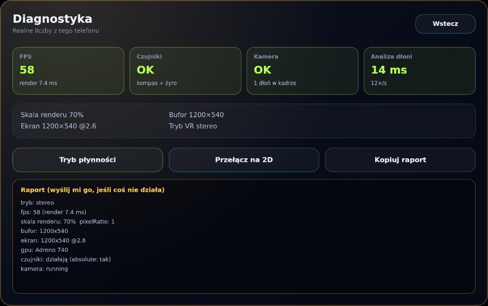
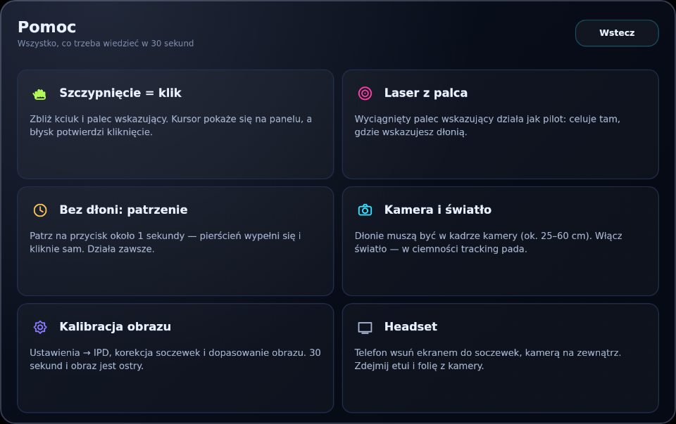

# VisionPocket

**VR i MR w Twojej kieszeni.** Telefon w tanim headsecie (Cardboard) + śledzenie dłoni z kamery.
Bez kontrolerów, bez gogli za 2500 zł, bez instalowania czegokolwiek na komputerze.

> Wersja 0.2 — wirtualny dom, kino 360°, galeria, gra, notatki, ustawienia optyki, pełne
> sterowanie dłońmi i **panel diagnostyki wydajności** (FPS, czujniki, kamera).

## Co nowego w 0.2 (naprawa „24 FPS i to nie VR”)

Trzy realne przyczyny problemów zgłoszonych po teście na telefonie:

| Problem | Przyczyna | Poprawka |
|---|---|---|
| „To nie jest VR” | po 0,7 s bez odczytu czujników aplikacja **na stałe** przeskakiwała na płaski 2D | watchdog czeka do 6 s, sam **wraca do VR**, gdy czujniki zadziałają; ręczny przełącznik VR/2D w Ustawieniach i Diagnostyce |
| czarne rogi / wycięty obraz | błąd maski w shaderze soczewek (`smoothstep` ucinał krawędzie) | maska usunięta, winieta robi to łagodnie |
| ~24 FPS i grzanie | MediaPipe 25×/s na głównym wątku + HUD rysowany co klatkę w 2× gęstości | analiza dłoni **12×/s** (5×/s bez dłoni) na mniejszym buforze 256×192; HUD max 30×/s i tylko przy zmianie; automatyczne schodzenie z jakości przy FPS < 46 |

Dodatkowo: **auto-start VR** przy kolejnym uruchomieniu (w headsecie nie ma jak kliknąć),
wejście w VR dotknięciem w dowolne miejsce ekranu startowego, tap = klik, baner błędów na
wierzchu ekranu i „raport” do skopiowania z panelu Diagnostyka (Ustawienia → Diagnostyka).

---

## Tak to wygląda

Panele są renderowane jako tekstury 3D — poniżej zrzuty z prawdziwego kodu
(generowane testem `npm run smoke`, bez upiększeń).

| Dom | Kino |
|---|---|
|  |  |

| Gra | Notatki |
|---|---|
|  |  |

| Galeria | Ustawienia | Diagnostyka |
|---|---|---|
|  |  |  |

Pomoc: 

---

## Co to potrafi

| Funkcja | Status |
|---|---|
| Obraz stereo dla dwojga oczu + korekcja soczewek | ✅ |
| Śledzenie głowy (żyroskop, 3DoF) z „recenter” | ✅ |
| **Śledzenie dłoni z tylnej kamery** (MediaPipe, offline) | ✅ |
| Szczypnięcie = klik, laser z palca, podgląd szkieletu dłoni | ✅ |
| Fallback: patrzenie + przytrzymanie (~1 s) = klik | ✅ |
| Tryb MR: obraz z kamery jako tło (jeśli headset ma okno na kamerę) | ✅ |
| Wirtualny dom: panele, dock, zegar, status sprzętu | ✅ |
| Kino: filmy 2D i 360° | ✅ |
| Galeria: zdjęcia i panoramy sferyczne | ✅ |
| Gra: „Neonowe cele” — strzelanie szczypaniem | ✅ |
| Notatki z dyktowaniem głosem (Chrome) | ✅ |
| Ustawienia: IPD, FOV, soczewki, jasność, skala renderu, jakość | ✅ |
| APK (Capacitor, GitHub Actions → Releases) | ✅ |
| 6DoF / chodzenie po scenie (ARCore) | 🔜 plan |
| Hand tracking bez kamery (IR) | ❌ wymaga sprzętu |

### Uczciwie o ograniczeniach

To nie jest „Quest 3 za 100 zł” — to **inna klasa sprzętu, ale ta sama klasa doświadczenia**:

- **3DoF, nie 6DoF.** Głowa się obraca, ale świat nie reaguje na krok do przodu. Quest ma 6DoF.
- **Ostrość ~8–12 PPD** (Quest 3: ~25 PPD). Dlatego UI jest duże i kontrastowe.
- **Dłonie widzi tylko kamera** (ok. 70° kadru) — gdy wyjdziesz ręką z kadru, kursor znika.
- **Ręce w VR nie są śledzone tak precyzyjnie jak w Queście** — dlatego mamy asystę (szczypanie
  z tolerancją, „dwell”, powiększone przyciski).
- **Brak passthrough MR bez otworu na kamerę** w headsecie.
- **Cień / brakujące piksele przy mocnej korekcji soczewek** — kompromis fizyki.

---

## Szybki start

### 1. W przeglądarce (najszybszy test, bez instalacji)

```bash
npm ci
npm run dev -- --host 0.0.0.0
```

Otwórz adres na telefonie **przez HTTPS** (np. tunel Vercel/ngrok) — kamera i czujniki wymagają
bezpiecznego kontekstu. Wpisz na telefonie: **Wejdź w VR** → załóż headset.

### 2. APK na Android

Najnowszy plik: **https://github.com/rejson59/VisionPocket/releases** → `VisionPocket.apk`.

Instalacja: pobierz na telefon → „Zainstaluj” → zezwól na instalację z nieznanych źródeł.

Build lokalny (wymaga JDK 21 + Android SDK):

```bash
npm ci
npm run build
npx cap add android
node scripts/patch-android.mjs
npx cap sync android
cd android && ./gradlew assembleDebug
# → android/app/build/outputs/apk/debug/app-debug.apk
```

Build automatyczny: GitHub Actions (`.github/workflows/android-apk.yml`) przy każdym pushu
i tagu `v*`, wynik trafia do Releases pod tagiem `apk-latest`.

---

## Jak się tego używa

1. **Zanim włożysz telefon do headsetu:** dodaj filmy/zdjęcia i włącz kamerę (przyciski na
   ekranie startowym). Później ekran telefonu jest już za soczewkami.
2. Wsuń telefon ekranem do soczewek, kamerą na zewnątrz, zdejmij etui.
3. **Wejdź w VR**. Trzymaj dłoń 25–60 cm przed sobą, w zasięgu kamery.
4. **Szczypnij** kciuk z palcem wskazującym, żeby kliknąć. Wyciągnięty palec = laser.
5. Nie widzisz dłoni? Patrz na przycisk ~1 s — pierścień wypełni się i kliknie.
6. Ustawienia → **IPD**, **korekcja soczewek**, **dopasowanie obrazu** — 30 sekund i obraz jest ostry.
7. Wolne klatki? Zmniejsz **skalę renderu** do ~70% (albo jakość „Niska”).

Dodatkowe sterowanie: pad Bluetooth (A/trigger = klik, prawa gałka = rozglądanie),
klawiatura (`WASD`/strzałki, spacja = klik, `R` = recenter, `Esc` = wstecz).

---

## Architektura

```
src/
  core/        App (pętla, wejście, routing aplikacji), ustawienia, media, dźwięk
  vr/          StereoRenderer (dwa oczy + shader dystorsji), HeadTracker (żyroskop)
  input/       HandTracker (MediaPipe offline), HandVisuals, PointerSystem (dłoń/wzrok/mysz)
  ui/          Panel (canvas → tekstura 3D), HUD (celownik/dwell), draw (mini-toolkit UI)
  world/       Environment (kopuła, siatka, cząsteczki, sfera MR)
  apps/        Home, Cinema, Gallery, Game, Notes, Settings, Help
```

- **Zero zależności UI** — panele rysujemy własnym mini-toolkitem na canvasach 2D i wrzucamy jako
  tekstury; dzięki temu tekst jest duży i czytelny na słabych soczewkach.
- **Stereo**: scena renderowana dwa razy (oczy ±IPD/2), potem jeden pass z baryłkową dystorsją,
  aberracją chromatyczną, winietą i korekcją kolorów.
- **Dłonie**: MediaPipe Hands (WASM + modele w paczce npm) → 21 punktów → pozycja 3D z estymacją
  głębi po rozpiętości dłoni → wygładzanie → szczypanie (kciuk–wskazujący) → klik.
- **Offline**: modele MediaPipe są kopiowane z `node_modules` do `public/mediapipe` przy buildzie,
  więc APK nie pobiera nic z internetu.

---

## Roadmapa

- [ ] **Dyktowanie w APK** — Android WebView nie ma Web Speech API; potrzebny mały natywny plugin
      (`SpeechRecognizer`).
- [ ] **6DoF przez ARCore** — kamera + VIO: pochylanie i krok do przodu (telefony wspierane).
- [ ] **Kalibracja kodem QR** headsetu (profile soczewek jak w Cardboard SDK).
- [ ] **Więcej aplikacji**: przeglądarka, YouTube, zdjęcia 3D SBS, wideo sferyczne z plików.
- [ ] **Multiplayer / wspólny pokój** (Supabase: presence + sync).
- [ ] **Hand tracking 2.0** — gesty: „open palm” pauza, „peace” cofanie, chwytanie paneli.
- [ ] **Nagrywanie/stream** — podgląd VR na drugim telefonie (WebRTC).

---

## Test dymny

```bash
npm run smoke     # renderuje i klika wszystkie ekrany (11/11 OK)
npm run screens   # odświeża zrzuty w docs/screens (JPEG 960 px)
```

`smoke` renderuje każdy ekran na canvasie (Skia), klika wszystkie obszary interaktywne,
sprawdza raycast wskaźnika i zapisuje zrzuty do `tools/smoke/shots/`. Bez przeglądarki — działa
w Node.

## Wydajność — co ustawić, gdy telefon nie daje 60 FPS

1. **Ustawienia → Diagnostyka**: zobacz FPS, czas renderu (`render X ms`), tempo analizy dłoni
   i to, czy czujniki w ogóle odpowiadają.
2. Jeśli FPS < 50: **Tryb płynności** (jeden przycisk) — skala renderu 55%, mniej efektów,
   analiza dłoni 8×/s.
3. Ręcznie: `Skala renderu` 50–70%, `Analiza dłoni` 8–12×/s, `Jakość: Niska`.
4. `Ostrość (piksele)` podnieś do 2× dopiero, gdy FPS jest stabilne — to najdroższa opcja.

Automat sam obniża jakość po ~1,5 s poniżej 46 FPS (skala → 52%, potem gęstość pikseli 0,8,
wyłączenie aberracji, szkieletu dłoni i zejście do 8×/s).

## Licencje i podziękowania

- [three.js](https://threejs.org) — MIT
- [MediaPipe Hands](https://ai.google.dev/edge/mediapipe/solutions/vision/hand_landmarker) — Apache 2.0
- [Capacitor](https://capacitorjs.com) — MIT

Projekt edukacyjno-hobbystyczny. VR bywa męczący — rób przerwy i zadbaj o miejsce wokół siebie.
